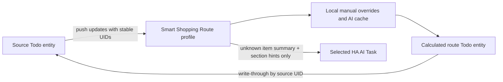

# Smart Shopping Route

Smart Shopping Route is a Home Assistant 2026.8+ custom integration that presents an existing to-do list in the walking order of a user-configured shop. The source list remains authoritative: the derived Todo entity preserves source UIDs and writes creates, edits, completion changes, and deletes back to the source.



## Requirements

- Home Assistant 2026.8.0 or newer.
- A source Todo entity that supports item updates.
- An AI Task entity that supports **Generate data** and structured output.
- HACS for the recommended installation path.

The integration has no provider-specific API dependency. It uses Home Assistant's AI Task abstraction, so it works with any compatible provider configured by the user.

## Install with HACS

1. Open the public [`sinalkumar/ha-shopping-list`](https://github.com/sinalkumar/ha-shopping-list) repository.
2. In HACS, open **Integrations**, choose the three-dot menu, then **Custom repositories**.
3. Enter the repository URL, select **Integration**, and add it.
4. Install **Smart Shopping Route** and restart Home Assistant.
5. Go to **Settings → Devices & services → Add integration**, search for **Smart Shopping Route**, and complete the flow.

## Configure a profile

Choose a profile name, source Todo entity, AI Task entity, and route sections. Each non-empty line uses:

```text
SECTION NAME | optional classification hints
```

For example:

```text
Produce | fruit and vegetables
Bakery | bread and bakery
Pantry | cereal, pasta, rice, canned foods
Frozen | frozen food
Dairy | milk, cheese, yoghurt
Household | cleaning supplies
```

Order is preserved exactly. Section names are case-insensitively unique. The integration appends **Unclassified / Other** automatically. Change a profile later with **Settings → Devices & services → Smart Shopping Route → Reconfigure**. Reordering sections immediately reorders the view without new AI calls.

Two profiles may share one source list; their route definitions and caches remain independent.

## How it behaves

When `Apples`, `Bread`, `Pasta`, and `Milk` appear in the source, unknown names initially appear at the end while up to three AI classifications run concurrently. Results are cached locally per profile, then items move into route order. Items in the same section preserve source order.

Completed items are hidden by default. If **Show completed items** is enabled, incomplete items remain before completed items. Manual drag movement is deliberately not exposed because route order is calculated.

All proxy operations use the source UID. Duplicate summaries are therefore independent. Creating through the route waits for the source to publish the new item and UID; the integration never invents a shadow identifier.

The optional display prefix produces names such as `Dairy · Milk` in the proxy only. It is stripped from edits before forwarding and never decorates the source value.

## Actions and Assist

- `smart_shopping_route.refresh`: read the source immediately and classify unknown items.
- `smart_shopping_route.set_item_section`: set a section by source UID. With `remember: true` (default), future occurrences of the normalized summary use it.
- `smart_shopping_route.forget_item_section`: remove a UID/manual/cached decision and retry classification.
- `smart_shopping_route.reclassify_all`: clear non-manual AI decisions and classify current items. **This may create billable requests.**
- `smart_shopping_route.clear_cache`: clear AI cache while preserving manual overrides unless `include_manual: true`.

Each profile also creates a **Refresh shopping route** button suitable for exposure to Assist. Costly or destructive actions are not buttons.

## Cache and failure handling

Summary normalization uses Unicode NFKC, case folding, trimming, and whitespace collapse. Quantities and numbers are retained. Manual overrides win over AI cache. The cache is profile-local, persisted in Home Assistant storage, capped at 2,000 AI/manual summary entries, and removes least-recently-used non-manual entries first.

An unavailable or invalid AI response leaves the item in **Unclassified / Other** and is not cached. AI failure cannot mutate the source. Source updates are push-driven through `TodoListEntity.async_subscribe_updates`; there is no interval poll.

## Privacy

For each unknown item, the integration sends only:

- that item's summary;
- configured section names; and
- configured section hints.

Shopping item names and store section descriptions are sent to the AI Task provider selected by the user. Data handling therefore depends on that provider. No other Home Assistant state, location, history, credentials, or network information is sent. Diagnostics contain counts and feature flags only, never item text, UIDs, profile names, entity IDs, or hints.

## Troubleshooting

- **Route unavailable:** confirm both selected dependency entities exist and are available. Reconfigure if an entity ID changed.
- **Items stay unclassified:** test the selected AI Task in Home Assistant, press the refresh button, and inspect sanitized Home Assistant logs.
- **Wrong section:** call `set_item_section` with the source UID and `remember: true`.
- **Changed hints:** call `reclassify_all` if you want new classifications; route order changes alone need no reclassification.
- **Debugging:** enable debug logging for `custom_components.smart_shopping_route`. Logs intentionally omit item summaries.

## Limitations in v0.1.0

- No manual `MOVE_TODO_ITEM`; sorting is calculated.
- The config form uses one multiline route field rather than a drag-and-drop editor.
- A section rename is treated as removal plus addition, invalidating only decisions that referenced the old name.
- Home Assistant 2026.8 still requires an isolated internal `EntityComponent` lookup to obtain the source Todo entity for push subscriptions.

## Uninstall

Remove every Smart Shopping Route config entry, uninstall it in HACS, and restart Home Assistant. Source lists and items are not deleted. Home Assistant may retain the integration's small local cache file until manually cleaned from internal storage; never edit `.storage` while Home Assistant is running.

See [CONTRIBUTING.md](CONTRIBUTING.md) and [SECURITY.md](SECURITY.md) before opening a public issue or pull request.
