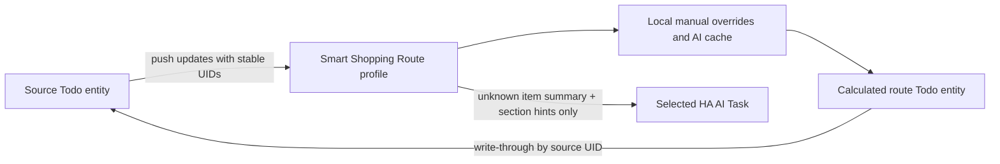

# Smart Shopping Route

Smart Shopping Route is a Home Assistant 2026.8+ custom integration that presents an existing to-do list in the walking order of a user-configured shop. The source list remains authoritative: the derived Todo entity preserves source UIDs and writes creates, edits, completion changes, and deletes back to the source.

It can optionally add a price and specials indicator from a New Zealand supermarket, so each item shows what it costs and what is currently discounted.



## Requirements

- Home Assistant 2026.8.0 or newer.
- A source Todo entity that supports item updates.
- An AI Task entity that supports **Generate data** and structured output.
- HACS for the recommended installation path.

The integration has no provider-specific API dependency. It uses Home Assistant's AI Task abstraction, so it works with any compatible provider configured by the user.

## Install with HACS

1. Open the public [`sinalkumar/ha-shopping-list`](https://github.com/sinalkumar/ha-shopping-list) repository.
2. In HACS, open **Integrations**, choose the three-dot menu, then **Custom repositories**.
3. Enter the repository URL, select **Integration**, and add it.
4. Install **Smart Shopping Route** and restart Home Assistant.
5. Go to **Settings → Devices & services → Add integration**, search for **Smart Shopping Route**, and complete the flow.

## Configure a profile

Choose a profile name, source Todo entity, AI Task entity, and route sections. Each non-empty line uses:

```text
SECTION NAME | optional classification hints
```

For example:

```text
Produce | fruit and vegetables
Bakery | bread and bakery
Pantry | cereal, pasta, rice, canned foods
Frozen | frozen food
Dairy | milk, cheese, yoghurt
Household | cleaning supplies
```

Order is preserved exactly. Section names are case-insensitively unique. The integration appends **Unclassified / Other** automatically. Profile names are also unique: creating or renaming a profile to a name already in use is refused on the form, and renaming a profile frees its old name.

Change a profile later with **Settings → Devices & services → Smart Shopping Route → Reconfigure**. Reconfiguring renames the config entry to the new profile name and reorders the view immediately without new AI calls.

Two profiles may share one source list; their route definitions and caches remain independent.

## How it behaves

When `Apples`, `Bread`, `Pasta`, and `Milk` appear in the source, unknown names initially appear at the end while up to three AI classifications run concurrently. Results are cached locally per profile, then items move into route order. Items in the same section preserve source order.

Completed items are hidden by default. If **Show completed items** is enabled, incomplete items remain before completed items. Manual drag movement is deliberately not exposed because route order is calculated.

All proxy operations use the source UID. Duplicate summaries are therefore independent: two `Milk` entries can sit in different sections. Creating through the route forwards the item to the source and returns; the item appears in the calculated view when the source publishes it with its own UID. The integration never invents a shadow identifier.

The optional display prefix produces names such as `Dairy · Milk` in the proxy only. It is applied only while **Prefix item names with their section** is enabled, and only then is it stripped from edits before forwarding. The source value is never decorated.

Each profile appears as one service device, grouping the calculated Todo entity, the refresh button, and the status sensor.

## Actions and Assist

All actions use the standard target selector, so an entity, device, area, floor, or label that resolves to exactly one route works. Targeting an ambiguous selection is refused:

- `smart_shopping_route.refresh`: read the source immediately and classify unknown items.
- `smart_shopping_route.set_item_section`: set a section by source UID. With `remember: true` (default), future occurrences of the normalized summary use it; with `remember: false`, only that one item is corrected.
- `smart_shopping_route.forget_item_section`: remove a UID/manual/cached decision and retry classification.
- `smart_shopping_route.reclassify_all`: clear non-manual AI decisions and classify current items. **This may create billable requests.**
- `smart_shopping_route.clear_cache`: clear AI cache while preserving manual overrides unless `include_manual: true`.

```yaml
action: smart_shopping_route.set_item_section
target:
  entity_id: todo.example_supermarket
data:
  item_uid: "01J8Z3K5N7QF2V6B4M9CX1T8RD"
  section: Household
  remember: true
```

The source item UID is the stable identifier the source to-do integration assigns to an item. The calculated list does not display it; read it from the source integration or its own API when you need to correct one specific duplicate.

Each profile also creates a **Refresh shopping route** button suitable for exposure to Assist. Costly or destructive actions are not buttons.

## Prices and specials

Pricing is optional per profile and off by default. Set **Price source** while configuring or reconfiguring a profile:

| Price source | Store needed | What you get |
|---|---|---|
| No prices | — | Route only. Item names go only to the AI Task. |
| Woolworths | No | Price per item, plus a real was-price and savings when the item is on special. Anonymous search is not store-scoped, so this is the online price. |
| Pak'nSave | Yes | Per-store price. The Foodstuffs API exposes **no was-price at all**, so no specials are claimed for this chain. |

When enabled, each incomplete item gains a description such as `$8.50 · was $9.70 · Anchor Butter 500g`, which the standard to-do card already renders. Two sensors are added:

- **Basket total**: the sum of known prices, with `priced_items`, `unmatched_items`, and `special_savings` attributes.
- **Specials**: how many listed items are discounted, with an `items` attribute carrying `summary`, `product`, `price`, `was_price`, `savings`, and `valid_until` for each one.

Prices refresh every 12 hours on their own schedule, and each item is priced once and then reused, so adding one item does not re-price the list. Pricing never blocks the route: a slow or failing retailer leaves the list working, and a failed lookup backs off instead of retrying every cycle.

### Matching

Item names are matched to retailer product titles by comparing words, so `Weetbix` finds `Weet-Bix`, and `Toilet paper` finds `Toilet Tissues`. When an item has a bracketed qualifier the plain term is searched first and the qualifier is added only if nothing good is found, which keeps `Tuna (olive oil)` from resolving to a bottle of olive oil. A candidate must match enough of the item's words or **no price is shown**: showing nothing is better than showing the wrong product.

### Pinning a product

Household shorthand rarely looks like a product title. When automatic matching cannot find something, pin it once and the pin persists across restarts:

```yaml
action: smart_shopping_route.pin_item_product
target:
  entity_id: todo.woolworths_manukau_mall
data:
  item_uid: "0123456789abcdef0123456789abcdef"
  query: Kids Multivitamin Gummies
  product_id: "1234567"
```

- `query` is searched instead of the item name. This alone is usually enough: `Kids vitamins` plus `Kids Multivitamin Gummies` resolves to *Example Brand Kids Multivitamin Gummies 110 Pack*.
- `product_id` is optional and pins one exact product. With it set, only that product is accepted, so the 30-pack and 110-pack of the same gummies can never be confused. If the retailer stops stocking it, no price is shown rather than a near-miss being substituted.
- `unpin_item_product` forgets the decision and returns to automatic matching.

Pins are per profile and per chain, because each retailer has its own catalogue. A pin survives the item being ticked off and added again.

### Price drops

Woolworths publishes a real was-price, so specials are detected from it. Pak'nSave publishes none at all, so for that chain the reference is **our own previous reading**: an item is reported as a drop when it is cheaper than the last time we priced it. That is why the Specials sensor reports a count from both signals, and its attributes separate `items` (retailer specials) from `price_drops` (falls since the last reading).

Price history and pins are stored in `.storage/smart_shopping_route.prices.<entry_id>` so a restart does not reset them, and both are deleted when the profile is removed.

Known limits: Pak'nSave prices are per store, so a profile is tied to the store chosen at setup, and the drop signal only becomes meaningful after the first price change.

## Cache, retries, and failure handling

Summary normalization uses Unicode NFKC, case folding, trimming, and whitespace collapse. Quantities and numbers are retained. Manual overrides win over AI cache, and a remembered correction supersedes an earlier per-item correction. The cache is profile-local, persisted in Home Assistant storage, capped at 2,000 AI/manual summary entries, and removes least-recently-used non-manual entries first. Per-item corrections are dropped when their item leaves the source list.

An AI answer below 0.5 confidence is treated as **Unclassified / Other** and cached that way, so a genuinely unclassifiable item is not sent to the provider again. A failed, invalid, or unavailable AI response is never cached; it is retried with capped exponential backoff (one minute, doubling, at most one hour) and the backoff resets on **refresh**, a manual correction, or **reclassify all**. AI failure cannot mutate the source. Source updates are push-driven through `TodoListEntity.async_subscribe_updates`; there is no interval poll.

The calculated route depends only on the source list, so it stays available when the AI Task entity is unavailable. AI Task health is reported separately by the status sensor's `ai_available` attribute and by diagnostics.

## Privacy

Two kinds of request leave Home Assistant, both with the minimum data needed.

**To the AI Task provider**, for each unknown item:

- that item's summary;
- configured section names; and
- configured section hints.

**To the chosen supermarket**, only when a price source is enabled: the item summary, as a product search term. This is opt-in per profile, and choosing **No prices** keeps item names away from retailers entirely.

No other Home Assistant state, history, or credentials are sent to either. Price lookups are anonymous: no account and no login, they run in a dedicated session with a dummy cookie jar so retailer cookies are discarded, and nothing about your basket is written to the retailer.

For Pak'nSave the chosen store ID is sent with each lookup, because prices are per store. That identifies which store you shop at, so use **No prices** or Woolworths if you would rather not share it.

Locally, the profile cache persists normalized item summaries and their sections in Home Assistant storage (`.storage/smart_shopping_route.cache.<entry_id>`) so classification is not repeated. That file is local user data and is deleted when the config entry is removed. Prices are held in memory only. Diagnostics contain counts and feature flags only, never item text, UIDs, product names, profile names, entity IDs, or hints. Logs never include item summaries.

## Troubleshooting

- **Route unavailable:** confirm the selected source entity exists and is available. The AI Task entity is not required for availability. Reconfigure if an entity ID changed.
- **Items stay unclassified:** test the selected AI Task in Home Assistant, press the refresh button, and inspect sanitized Home Assistant logs. The status sensor's `pending_classifications` and `scheduled_retries` attributes show whether work is queued or backing off.
- **Wrong section:** call `set_item_section` with the source UID and `remember: true`.
- **An item shows no price:** the retailer's search had no confident match. Rename the item to something closer to a product title, or accept it staying unpriced. `unmatched_items` on the basket total sensor shows how many are in that state.
- **Prices look like the wrong product:** pin the item with `pin_item_product` and, if needed, its exact `product_id`. Matching prefers the retailer's own relevance order, so the plainest product usually wins, but shorthand and supplements still need a pin.
- **Changed hints:** call `reclassify_all` if you want new classifications; route order changes alone need no reclassification.
- **Debugging:** enable debug logging for `custom_components.smart_shopping_route`. Logs intentionally omit item summaries.

## Limitations in v0.2.0

- No manual `MOVE_TODO_ITEM`; sorting is calculated.
- The config form uses one multiline route field rather than a drag-and-drop editor.
- A section rename is treated as removal plus addition, invalidating only decisions that referenced the old name.
- Corrections are keyed by source UID, which the calculated list does not display.
- Home Assistant 2026.8 still requires an isolated internal `EntityComponent` lookup to obtain the source Todo entity for push subscriptions.
- Prices are estimates from public product search, not a quote. Quantities in item names are not interpreted, so `2x milk` is priced as one unit.
- Price drops compare against the previous reading only, not a long trend, so a price that fell before the feature was enabled is not reported.
- Woolworths prices are the online price and are not tied to a physical store.
- No manual product pin yet, and no price history beyond the current reading for Pak'nSave.

## Uninstall

Remove every Smart Shopping Route config entry, uninstall it in HACS, and restart Home Assistant. Removing a config entry deletes its classification cache file. Source lists and items are not deleted. Never edit `.storage` while Home Assistant is running.

See [CONTRIBUTING.md](CONTRIBUTING.md) and [SECURITY.md](SECURITY.md) before opening a public issue or pull request.
